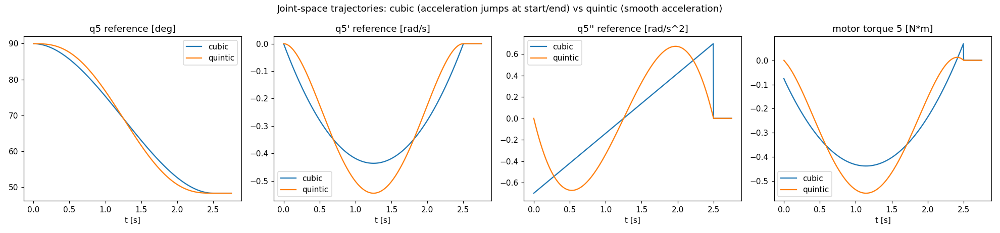
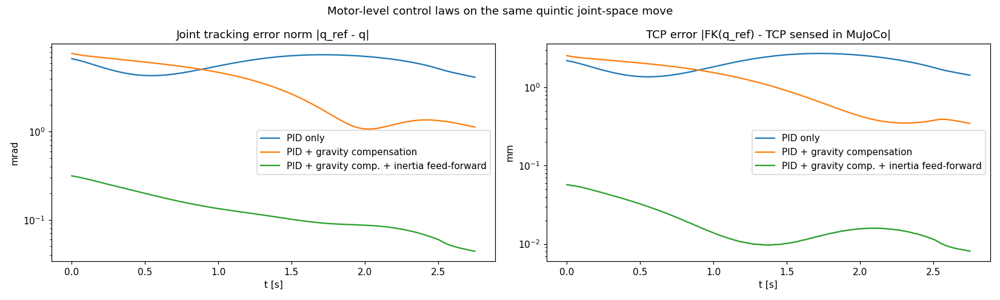
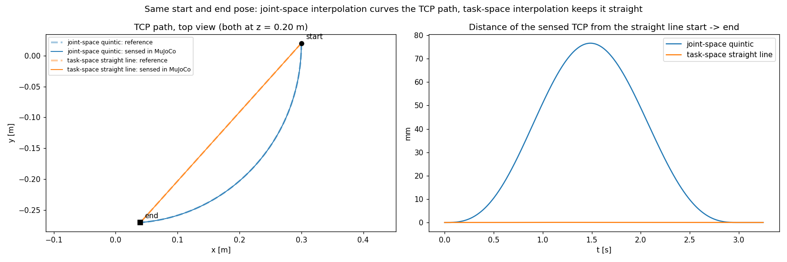
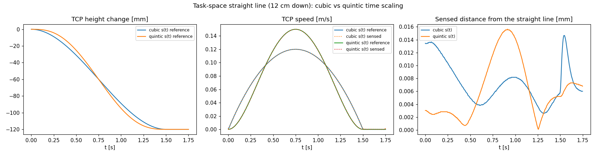
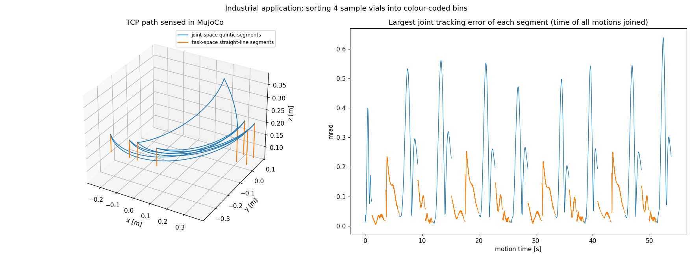
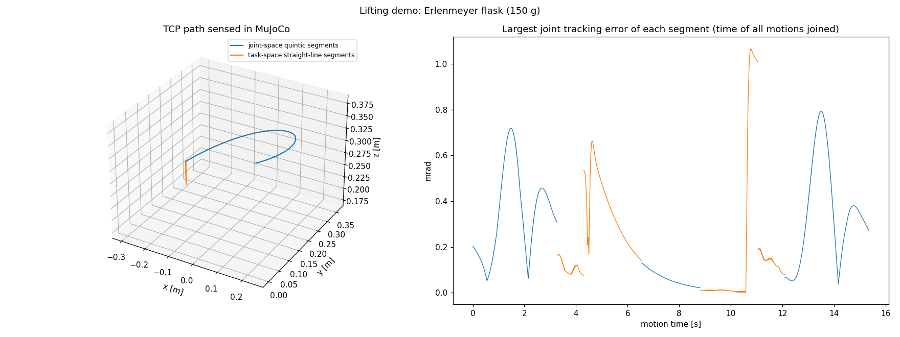

# Milestone 4 validation summary (ROS2 + MuJoCo)

Generated by `validation/plot_validation.py` from the controller logs in `validation/runs/`.
Joint errors: reference q_ref vs angle measured in the simulator. TCP error: FK(q_ref) vs the TCP site sensed in MuJoCo (`/ee_pose`). Line deviation: sensed TCP distance from the commanded straight line. FK vs sim: DH forward kinematics of the measured angles vs the sensed TCP (includes up to 1 sim step of message offset).

| # | experiment / step | trajectory | control | max joint err [mrad] | RMS [mrad] | max TCP err [mm] | line dev. [mm] | FK vs sim [mm] | peak torque [N*m] |
|---|---|---|---|---|---|---|---|---|---|
| 1 | reset | joint-space quintic (2.50 s) | PID+G+FF | 0.000 | 0.000 | 0.001 | nan | 0.001 | [0.0, 5.0, 5.0, 0.4, 0.0, 0.0] |
| 2 | profile-cubic | joint-space cubic (2.50 s) | PID+G+FF | 0.028 | 0.009 | 0.008 | nan | 0.002 | [0.0, 9.1, 5.7, 0.4, 0.4, 0.0] |
| 3 | profile-cubic-back | joint-space cubic (2.50 s) | PID+G+FF | 0.022 | 0.006 | 0.006 | nan | 0.002 | [0.0, 9.1, 5.9, 0.4, 0.4, 0.0] |
| 4 | profile-quintic | joint-space quintic (2.50 s) | PID+G+FF | 0.043 | 0.013 | 0.011 | nan | 0.002 | [0.1, 9.0, 5.6, 0.4, 0.5, 0.0] |
| 5 | profile-quintic-back | joint-space quintic (2.50 s) | PID+G+FF | 0.027 | 0.009 | 0.008 | nan | 0.002 | [0.0, 9.1, 6.0, 0.4, 0.6, 0.0] |
| 6 | control-pid-only | joint-space quintic (2.50 s) | PID | 7.103 | 2.508 | 2.713 | nan | 0.002 | [0.1, 9.0, 5.6, 0.4, 0.5, 0.0] |
| 7 | control-pid-only-back | joint-space quintic (2.50 s) | PID | 5.914 | 1.696 | 1.890 | nan | 0.002 | [0.0, 9.1, 6.0, 0.4, 0.6, 0.0] |
| 8 | control-pid+gravity | joint-space quintic (2.50 s) | PID+G | 5.889 | 1.791 | 2.541 | nan | 0.002 | [0.1, 9.0, 5.6, 0.4, 0.6, 0.0] |
| 9 | control-pid+gravity-back | joint-space quintic (2.50 s) | PID+G | 2.285 | 0.646 | 0.350 | nan | 0.002 | [0.0, 9.1, 6.0, 0.4, 0.6, 0.0] |
| 10 | control-pid+gravity+feedforward | joint-space quintic (2.50 s) | PID+G+FF | 0.300 | 0.064 | 0.057 | nan | 0.002 | [0.1, 9.0, 5.6, 0.4, 0.5, 0.0] |
| 11 | control-pid+gravity+feedforward-back | joint-space quintic (2.50 s) | PID+G+FF | 0.033 | 0.011 | 0.007 | nan | 0.002 | [0.0, 9.1, 6.0, 0.4, 0.6, 0.0] |
| 12 | reset | joint-space quintic (1.00 s) | PID+G+FF | 0.010 | 0.004 | 0.003 | nan | 0.001 | [0.0, 5.0, 5.0, 0.4, 0.0, 0.0] |
| 13 | reset | joint-space quintic (2.50 s) | PID+G+FF | 0.046 | 0.013 | 0.012 | nan | 0.002 | [0.1, 9.0, 5.6, 0.4, 0.5, 0.0] |
| 14 | path-joint-space | joint-space quintic (3.00 s) | PID+G+FF | 0.160 | 0.044 | 0.035 | nan | 0.002 | [1.0, 8.9, 5.6, 0.3, 0.0, 0.0] |
| 15 | reset | joint-space quintic (2.00 s) | PID+G+FF | 0.390 | 0.102 | 0.086 | nan | 0.002 | [1.7, 8.9, 5.6, 0.3, 0.1, 0.0] |
| 16 | path-task-space | task-space line quintic (38.9 cm, 3.00 s) | PID+G+FF | 0.280 | 0.073 | 0.066 | 0.054 | 0.002 | [1.2, 9.1, 5.9, 0.3, 0.1, 0.2] |
| 17 | reset | joint-space quintic (2.00 s) | PID+G+FF | 0.401 | 0.104 | 0.091 | nan | 0.002 | [1.7, 8.9, 5.6, 0.3, 0.1, 0.0] |
| 18 | line-cubic | task-space line cubic (12.0 cm, 1.50 s) | PID+G+FF | 0.100 | 0.026 | 0.024 | 0.015 | 0.002 | [0.0, 10.9, 5.3, 0.3, 0.4, 0.0] |
| 19 | line-cubic-back | task-space line cubic (12.0 cm, 1.50 s) | PID+G+FF | 0.054 | 0.013 | 0.014 | 0.008 | 0.002 | [0.0, 11.0, 5.6, 0.3, 0.4, 0.0] |
| 20 | line-quintic | task-space line quintic (12.0 cm, 1.50 s) | PID+G+FF | 0.063 | 0.019 | 0.020 | 0.016 | 0.002 | [0.0, 10.7, 5.6, 0.3, 0.6, 0.0] |
| 21 | line-quintic-back | task-space line quintic (12.0 cm, 1.50 s) | PID+G+FF | 0.056 | 0.017 | 0.021 | 0.016 | 0.002 | [0.0, 11.0, 5.6, 0.3, 0.6, 0.0] |
| 22 | reset | joint-space quintic (2.50 s) | PID+G+FF | 0.030 | 0.009 | 0.008 | nan | 0.002 | [0.0, 9.1, 6.0, 0.4, 0.6, 0.0] |
| 23 | sorting: vial_1 (red): joint-space move above the vial | joint-space quintic (0.91 s) | PID+G+FF | 0.399 | 0.108 | 0.101 | nan | 0.002 | [0.2, 10.0, 6.2, 0.4, 1.6, 0.0] |
| 24 | sorting: vial_1 (red): straight line down to grasp | task-space line quintic (14.0 cm, 2.19 s) | PID+G+FF | 0.040 | 0.013 | 0.016 | 0.011 | 0.002 | [0.0, 10.9, 5.6, 0.3, 0.4, 0.0] |
| 25 | sorting: vial_1 (red): straight line up (lift) | task-space line quintic (14.0 cm, 2.19 s) | PID+G+FF | 0.235 | 0.065 | 0.132 | 0.092 | 0.002 | [0.0, 11.2, 5.6, 0.3, 0.4, 0.0] |
| 26 | sorting: vial_1 (red): joint-space move above the bin | joint-space quintic (2.96 s) | PID+G+FF | 0.533 | 0.141 | 0.158 | nan | 0.002 | [1.8, 11.5, 5.9, 0.3, 0.1, 0.0] |
| 27 | sorting: vial_1 (red): straight line down into the bin | task-space line quintic (7.0 cm, 1.09 s) | PID+G+FF | 0.154 | 0.050 | 0.050 | 0.029 | 0.002 | [0.0, 12.4, 5.7, 0.3, 0.4, 0.0] |
| 28 | sorting: vial_1 (red): straight line up | task-space line quintic (7.0 cm, 1.09 s) | PID+G+FF | 0.042 | 0.012 | 0.017 | 0.006 | 0.002 | [0.0, 12.5, 5.8, 0.3, 0.4, 0.0] |
| 29 | sorting: vial_2 (green): joint-space move above the vial | joint-space quintic (2.94 s) | PID+G+FF | 0.562 | 0.137 | 0.169 | nan | 0.001 | [1.7, 11.7, 5.7, 0.3, 0.0, 0.0] |
| 30 | sorting: vial_2 (green): straight line down to grasp | task-space line quintic (14.0 cm, 2.19 s) | PID+G+FF | 0.102 | 0.023 | 0.030 | 0.008 | 0.002 | [0.0, 12.8, 5.7, 0.3, 0.4, 0.0] |
| 31 | sorting: vial_2 (green): straight line up (lift) | task-space line quintic (14.0 cm, 2.19 s) | PID+G+FF | 0.253 | 0.069 | 0.153 | 0.093 | 0.002 | [0.0, 13.1, 5.7, 0.3, 0.4, 0.0] |
| 32 | sorting: vial_2 (green): joint-space move above the bin | joint-space quintic (2.57 s) | PID+G+FF | 0.553 | 0.147 | 0.164 | nan | 0.002 | [1.7, 11.5, 5.7, 0.3, 0.1, 0.0] |
| 33 | sorting: vial_2 (green): straight line down into the bin | task-space line quintic (7.0 cm, 1.09 s) | PID+G+FF | 0.147 | 0.046 | 0.036 | 0.023 | 0.002 | [0.0, 10.1, 5.6, 0.3, 0.5, 0.0] |
| 34 | sorting: vial_2 (green): straight line up | task-space line quintic (7.0 cm, 1.09 s) | PID+G+FF | 0.050 | 0.014 | 0.016 | 0.007 | 0.002 | [0.0, 10.2, 5.6, 0.3, 0.5, 0.0] |
| 35 | sorting: vial_3 (blue): joint-space move above the vial | joint-space quintic (2.83 s) | PID+G+FF | 0.472 | 0.121 | 0.106 | nan | 0.002 | [1.7, 9.3, 5.6, 0.3, 0.0, 0.0] |
| 36 | sorting: vial_3 (blue): straight line down to grasp | task-space line quintic (14.0 cm, 2.19 s) | PID+G+FF | 0.078 | 0.019 | 0.018 | 0.010 | 0.002 | [0.0, 11.2, 5.6, 0.3, 0.4, 0.0] |
| 37 | sorting: vial_3 (blue): straight line up (lift) | task-space line quintic (14.0 cm, 2.19 s) | PID+G+FF | 0.219 | 0.061 | 0.125 | 0.086 | 0.002 | [0.0, 11.5, 5.7, 0.3, 0.4, 0.0] |
| 38 | sorting: vial_3 (blue): joint-space move above the bin | joint-space quintic (2.11 s) | PID+G+FF | 0.498 | 0.131 | 0.115 | nan | 0.002 | [1.7, 9.5, 5.7, 0.3, 0.0, 0.0] |
| 39 | sorting: vial_3 (blue): straight line down into the bin | task-space line quintic (7.0 cm, 1.09 s) | PID+G+FF | 0.122 | 0.038 | 0.025 | 0.018 | 0.002 | [0.0, 9.1, 5.6, 0.3, 0.5, 0.0] |
| 40 | sorting: vial_3 (blue): straight line up | task-space line quintic (7.0 cm, 1.09 s) | PID+G+FF | 0.048 | 0.014 | 0.015 | 0.008 | 0.002 | [0.0, 9.2, 5.5, 0.3, 0.5, 0.0] |
| 41 | sorting: vial_4 (green): joint-space move above the vial | joint-space quintic (2.05 s) | PID+G+FF | 0.543 | 0.171 | 0.207 | nan | 0.002 | [2.0, 11.7, 6.1, 0.3, 0.2, 0.0] |
| 42 | sorting: vial_4 (green): straight line down to grasp | task-space line quintic (14.0 cm, 2.19 s) | PID+G+FF | 0.084 | 0.026 | 0.036 | 0.029 | 0.002 | [0.0, 13.1, 5.7, 0.3, 0.4, 0.0] |
| 43 | sorting: vial_4 (green): straight line up (lift) | task-space line quintic (14.0 cm, 2.19 s) | PID+G+FF | 0.250 | 0.068 | 0.153 | 0.091 | 0.002 | [0.0, 13.4, 5.8, 0.3, 0.4, 0.0] |
| 44 | sorting: vial_4 (green): joint-space move above the bin | joint-space quintic (2.58 s) | PID+G+FF | 0.544 | 0.155 | 0.179 | nan | 0.002 | [1.7, 11.9, 5.8, 0.3, 0.1, 0.0] |
| 45 | sorting: vial_4 (green): straight line down into the bin | task-space line quintic (7.0 cm, 1.09 s) | PID+G+FF | 0.136 | 0.046 | 0.035 | 0.027 | 0.002 | [0.0, 9.4, 5.6, 0.3, 0.5, 0.0] |
| 46 | sorting: vial_4 (green): straight line up | task-space line quintic (7.0 cm, 1.09 s) | PID+G+FF | 0.048 | 0.014 | 0.015 | 0.007 | 0.002 | [0.0, 9.5, 5.5, 0.3, 0.5, 0.0] |
| 47 | sorting: return home (joint space) | joint-space quintic (2.30 s) | PID+G+FF | 0.639 | 0.152 | 0.192 | nan | 0.002 | [1.6, 8.3, 6.1, 0.4, 0.7, 0.0] |
| 48 | lift: flask: joint-space move above the neck | joint-space quintic (3.01 s) | PID+G+FF | 0.718 | 0.213 | 0.336 | nan | 0.002 | [1.9, 13.1, 5.9, 0.4, 0.2, 0.0] |
| 49 | lift: flask: straight line down to the neck | task-space line quintic (5.0 cm, 0.78 s) | PID+G+FF | 0.168 | 0.063 | 0.087 | 0.052 | 0.002 | [0.0, 13.7, 5.9, 0.4, 0.5, 0.0] |
| 50 | lift: flask: lift 5 cm (task-space line) | task-space line quintic (5.0 cm, 2.00 s) | PID+G+FF | 0.663 | 0.190 | 0.387 | 0.126 | 0.002 | [0.0, 14.0, 6.2, 0.3, 0.2, 0.0] |
| 51 | lift: flask: hold it up | hold | PID+G+FF | 0.131 | 0.034 | 0.075 | nan | 0.002 | [0.0, 13.6, 6.0, 0.3, 0.0, 0.0] |
| 52 | lift: flask: put it back down | task-space line quintic (5.0 cm, 2.00 s) | PID+G+FF | 1.065 | 0.140 | 0.569 | 0.171 | 0.002 | [0.0, 13.9, 6.1, 0.3, 0.2, 0.0] |
| 53 | lift: flask: straight line up | task-space line quintic (5.0 cm, 0.78 s) | PID+G+FF | 0.194 | 0.070 | 0.105 | 0.026 | 0.002 | [0.0, 13.8, 6.2, 0.4, 0.5, 0.0] |
| 54 | lift: return home (joint space) | joint-space quintic (3.01 s) | PID+G+FF | 0.792 | 0.221 | 0.362 | nan | 0.002 | [1.5, 13.2, 5.6, 0.4, 0.3, 0.0] |

## Figures

